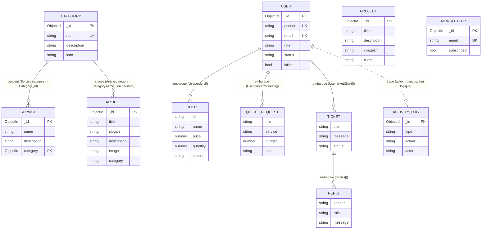

# Schéma des données et relations

Base : MongoDB (Mongoose). Les « tables » sont des collections ; les liens sont
soit des **références** (`ObjectId` + `ref`, équivalent d'une clé étrangère),
soit des **sous-documents embarqués** (équivalent d'une table enfant 1-N).



## Points à connaître

- Seul lien « clé étrangère » réel aujourd'hui : `Service.category -> Category`.
- `Article.category` est une chaîne (nom de catégorie), pas une référence : une
  catégorie renommée n'est pas répercutée. Passer à `ObjectId` + `ref: "Category"`
  est l'évolution naturelle si le jury attend une vraie relation.
- `Project`, `NewsLetter` sont autonomes (aucune relation).
- Commandes, devis et tickets sont embarqués dans `User` (choix document) ; en
  relationnel (MySQL) ce seraient des tables `orders`, `quote_requests`,
  `tickets`, `ticket_replies` avec une clé étrangère `user_id`.

## Équivalent relationnel (MySQL)

```sql
CREATE TABLE users (id INT AUTO_INCREMENT PRIMARY KEY, pseudo VARCHAR(30) UNIQUE, email VARCHAR(254) UNIQUE, role ENUM('user','admin','developper'));
CREATE TABLE categories (id INT AUTO_INCREMENT PRIMARY KEY, name VARCHAR(80) UNIQUE, description TEXT, icon VARCHAR(60));
CREATE TABLE services (id INT AUTO_INCREMENT PRIMARY KEY, name VARCHAR(160), description TEXT,
  category_id INT NOT NULL, FOREIGN KEY (category_id) REFERENCES categories(id));
CREATE TABLE articles (id INT AUTO_INCREMENT PRIMARY KEY, title VARCHAR(255), slogan VARCHAR(255), description TEXT, image TEXT,
  category_id INT NOT NULL, FOREIGN KEY (category_id) REFERENCES categories(id));
CREATE TABLE orders (id INT AUTO_INCREMENT PRIMARY KEY, user_id INT NOT NULL, name VARCHAR(160), price DECIMAL(10,2), quantity INT,
  status ENUM('En cours','Complété','En attente','Annulé'), FOREIGN KEY (user_id) REFERENCES users(id));
CREATE TABLE tickets (id INT AUTO_INCREMENT PRIMARY KEY, user_id INT NOT NULL, title VARCHAR(255), message TEXT, status VARCHAR(20),
  FOREIGN KEY (user_id) REFERENCES users(id));
CREATE TABLE ticket_replies (id INT AUTO_INCREMENT PRIMARY KEY, ticket_id INT NOT NULL, sender VARCHAR(60), message TEXT,
  FOREIGN KEY (ticket_id) REFERENCES tickets(id));
```
